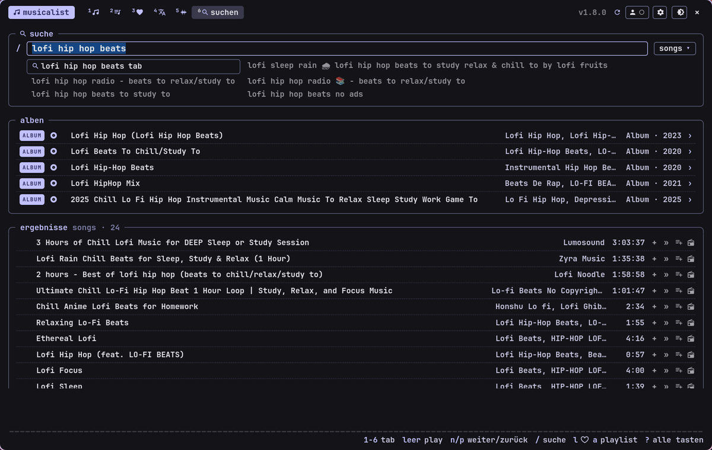

<!-- gh-header -->
<div align="center">


# musicalist

**youtube music player in the terminal look**

   

</div>

<p align="center"></p>

<p align="center"><!-- gh-note --><sub>tip: the glass button (󰃝, top right) makes the window see-through, like the terminal – needs a compositor with blur, e.g. hyprland.</sub></p>

youtube music player in the terminal look of the suite (gtk4): search, library, radio/autoplay, lyrics, spectrum
(cava), media keys (mpris), a detailed **listening analysis** with weekly, monthly and yearly reviews (tab 7) and,
if you want, a **preview card** that slides up at the bottom when the mouse hits the screen edge
(space = pause, ←/→ = previous/next track).

## install

the repository is public – no account needed:

```bash
git clone https://github.com/danger-inc/musicalist-public ~/musicalist-src
cd ~/musicalist-src && ./install.sh
```

the installer asks for the password once (for the system packages: gtk4, mpv, cava, playerctl), sets up its own
python environment for ytmusicapi/yt-dlp (`~/.local/share/rice-apps/music/venv`) and installs the command
`musicalist` and an application menu entry. packages that don't exist on your distribution are skipped
and listed at the end – everything else is installed anyway.

start with `musicalist` or from the application menu. calling it again shows/hides the window;
✕ / `q` exits musicalist completely and the music stops. to keep playing with the window closed:
settings (⚙ or `,`) → "beim schließen im hintergrund weiterspielen".

## nixos / nix

on nixos don't run `install.sh` – use the flake instead, so musicalist is part of your config.
add the input to your system or home-manager flake:

```nix
inputs.musicalist = {
  url = "github:danger-inc/musicalist-public";
  inputs.nixpkgs.follows = "nixpkgs";
};
```

then **either** home-manager (recommended – can also start musicalist with the session):

```nix
imports = [ inputs.musicalist.homeManagerModules.default ];
programs.musicalist.enable = true;
programs.musicalist.autostart = true;   # optional: background service with graphical-session.target
```

**or** system-wide in `configuration.nix`:

```nix
imports = [ inputs.musicalist.nixosModules.default ];
programs.musicalist.enable = true;
```

(there is also `overlays.default` → `pkgs.musicalist`, and `nix run <flake>` to just try it.)
the package brings everything along (gtk4, gtk4-layer-shell, mpv, cava, playerctl, node, ytmusicapi, yt-dlp).
because the program lives read-only in `/nix/store`, musicalist keeps its login, settings and history in
`~/.local/share/musicalist` – that survives every rebuild and garbage collection. yt-dlp still updates itself
(into `~/.local/share/musicalist/pylibs`), since youtube changes faster than nixpkgs.
update musicalist with `nix flake update musicalist` + rebuild; the update button only opens the repo page.
on hyprland without home-manager autostart: `exec-once = musicalist --daemon`.

## runs on

| system | status |
| --- | --- |
| ubuntu 24.04+, linux mint 22+, debian 13 | tested (ubuntu 24.04) |
| fedora 39+ | tested (fedora 44) |
| arch, endeavouros, cachyos, manjaro | tested (arch) |
| openSUSE Tumbleweed | should work (untested) |
| nixos (nixpkgs 26.05 / unstable) | via flake, see [nixos / nix](#nixos--nix) – tested build + playback |
| windows | core features (player, search, library, lyrics); no hover preview, spectrum or media keys – run install-windows.bat |
| macos | no |

required is **gtk 4.12 or newer** (older systems like ubuntu 22.04 / mint 21 / debian 12 are too old).
`mpv` plays the audio. `cava` (spectrum) and `playerctl` are optional.

## settings (⚙ or `,`)

* **preview card at the bottom edge (hover)** – **off** by default. needs wayland with layer-shell
(hyprland, sway, kde plasma …) and the package `gtk4-layer-shell`; not available on gnome and x11.
if it causes trouble: just leave it off.

## login

in the tab "bibliothek" click "mit zen/firefox anmelden": musicalist takes over the youtube session from your
zen, firefox or librewolf profile (snap/flatpak too). log in at music.youtube.com there first.
chrome/chromium don't work (they encrypt their cookies).
**playback needs a login with YouTube Premium:** searching and browsing work without, but tracks only play
once the google login is confirmed *and* the logged-in account has YouTube Premium (or Music Premium).
musicalist checks this itself (same signal yt-dlp uses: the premium logo on youtube.com for your session).

the login data stays local in `~/.local/share/rice-apps/music/auth` (permissions 600) and is never
uploaded anywhere.

## keys

space play/pause · n/p next/previous · ←/→ seek · +/− volume · l ♥ · a add to playlist · / search · 1–7 tabs ·
h history bar · v/f visuals mode/fullscreen · ? all keys · q closes (not esc – so you don't close it by accident).
in "analyse": w/m/j/g week/month/year/all time · page up/down earlier/later period · home back to now.

## listening analysis (tab 7)

musicalist keeps a precise log of what you play – only on your device (`hoerprotokoll.jsonl` next to the
settings), only while the history is switched on (settings), and you can delete it in the tab. per track it notes
how long you really listened, how it ended (finished, skipped, back, switched), seeking and pauses, where it came
from (radio, playlist, album, search …), the album, likes, volume and the output (headphones, speakers, bluetooth).

the tab shows a week, month, year or all time – flip back with ‹ ›, compared with the period before (up to the
same point while it's still running): listening time, plays, artists, albums, a calendar heatmap, top tracks /
artists / albums, discoveries and comebacks, a weekday × hour heatmap, typical start and end of your music day,
sessions and streaks, skip behaviour, sources and devices, variety, taste over time and milestones. when a week,
month or year is over, the status line says that its review is ready.

## hyprland (optional)

```lua
-- autostart (waits in the background), inside hl.on("hyprland.start", function () … end):
hl.exec_cmd(os.getenv("HOME") .. "/.local/bin/rice-music --daemon")
-- show/hide:
hl.bind("SUPER + M", hl.dsp.exec_cmd(os.getenv("HOME") .. "/.local/bin/rice-music"))
-- preview card (if enabled): fade in and blur behind it
hl.layer_rule({
    name         = "blur-music-preview",
    match        = { namespace = "^music-preview$" },
    blur         = true,
    ignore_alpha = 0.1,
    animation    = "slide bottom",
})
```

other desktops: bind a shortcut to the command `musicalist` (gnome: settings → keyboard →
custom shortcuts; kde: system settings → shortcuts).

## commands

`musicalist` (toggle) · `musicalist show|hide|play-pause|next|prev` · `musicalist search:term+with+plus`

## update / remove

```bash
cd ~/musicalist-src && ./update.sh      # fetches the new version, restarts musicalist
./uninstall.sh                          # removes everything including the login
```

## problems?

* **no sound / "wiedergabe fehlgeschlagen":** is `mpv` installed? (`mpv --version`). then run `./install.sh` again.
* **`musicalist: command not found`:** `~/.local/bin` is missing in `PATH` – the installer says at the end what belongs
in `~/.bashrc`. from the application menu it starts anyway.
* **boxes instead of symbols:** `./update.sh` (the icon font comes along and is loaded automatically).
* **doesn't start:** `cat $XDG_RUNTIME_DIR/rice-music.log` shows the error message.

<!-- gh-suite -->
## the -ist suite

all apps share one look (terminal style, colors from your wallpaper via matugen), one installer and the same shortcuts.

| app | what it does |
| --- | --- |
| [scourge](https://github.com/danger-inc/scourge-public) | inspect, edit, record, cut – and installs the others |
| [notist](https://github.com/danger-inc/notist-public) | notes · words · latex |
| [filist](https://github.com/danger-inc/filist-public) | file explorer + file dialog |
| [datist](https://github.com/danger-inc/datist) | calendar |
| [mailist](https://github.com/danger-inc/mailist-public) | mail |
| [linguist](https://github.com/danger-inc/linguist) | translator + hover corner |
| [sharist](https://github.com/danger-inc/sharist) | quick share |
| [wallist](https://github.com/danger-inc/wallist) | wallpapers |
| [inquirist](https://github.com/danger-inc/inquirist) | launcher |

dotfiles with the matching hyprland setup: [danger-inc/dotfiles](https://github.com/danger-inc/dotfiles)
